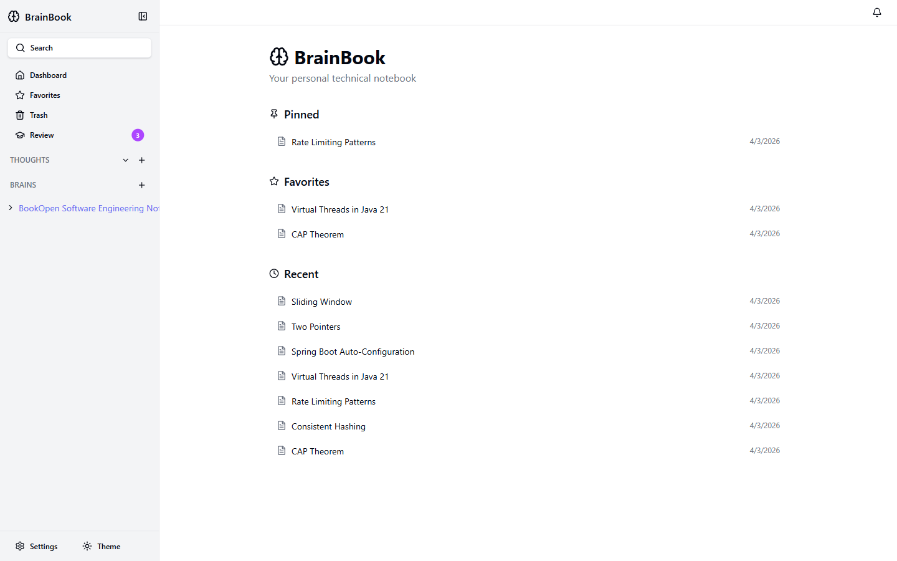
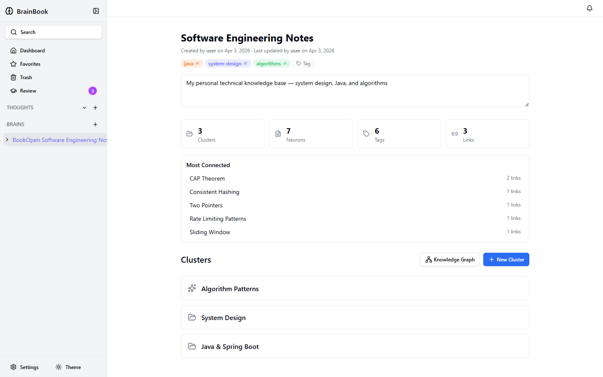
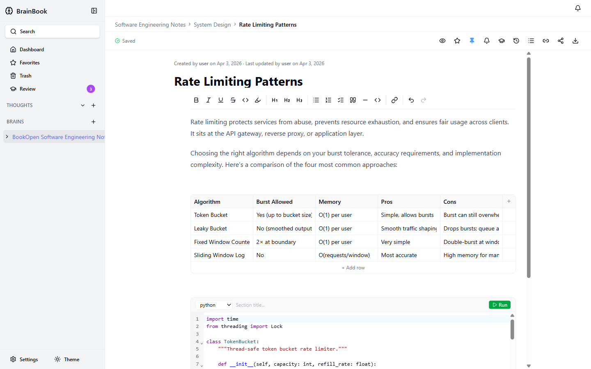
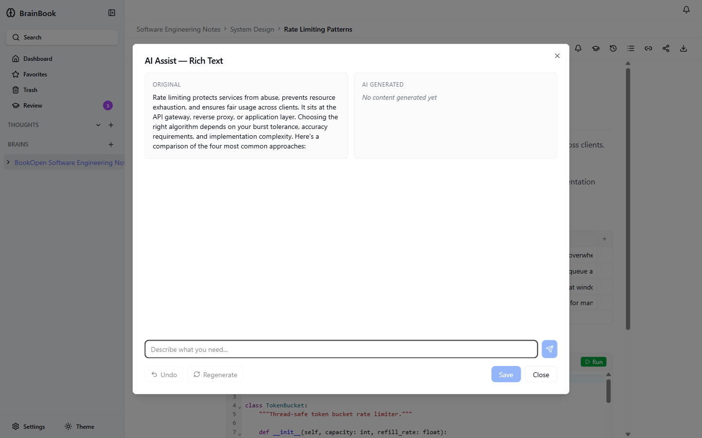
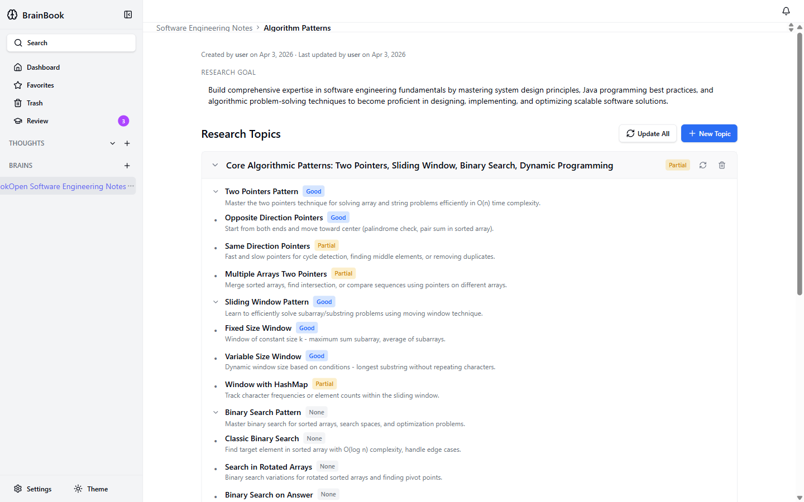
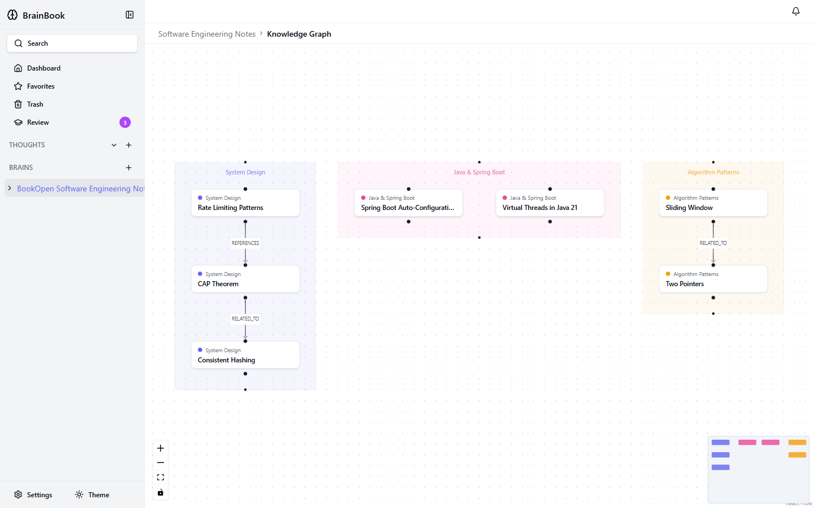
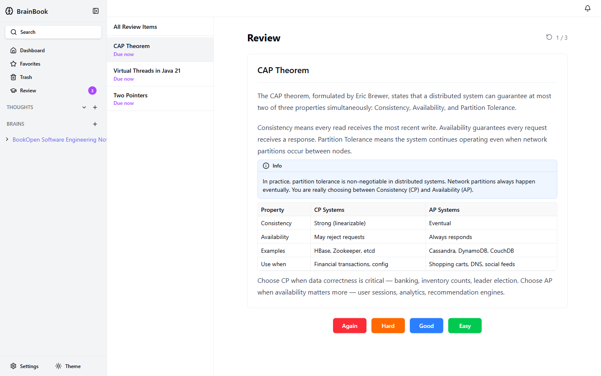
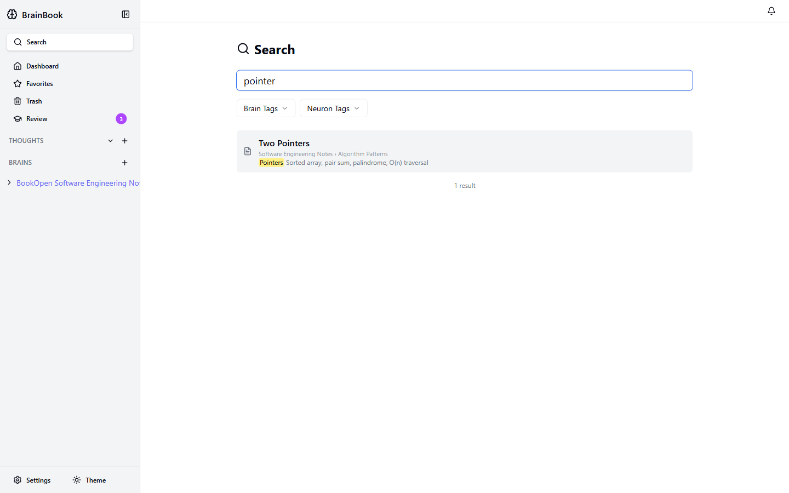
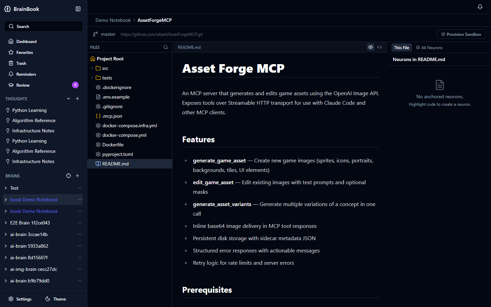
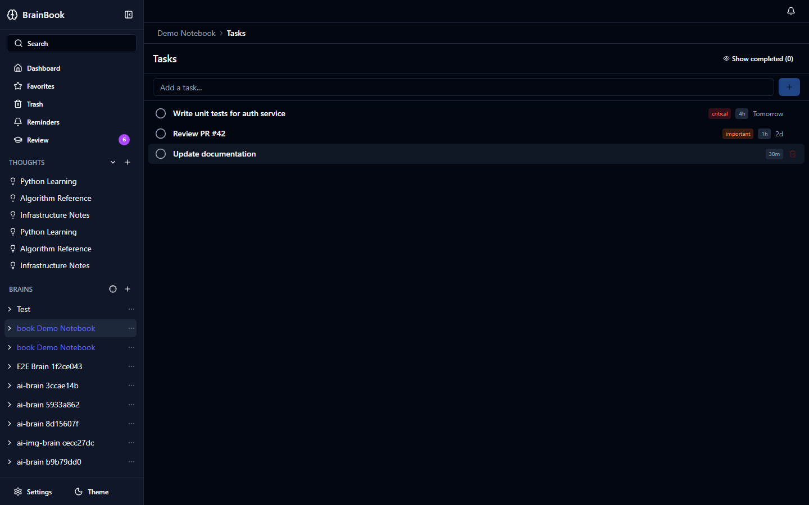

# BrainBook

**A self-hosted personal knowledge base** with AI-assisted writing, spaced repetition learning, code-anchored notes, and knowledge graph visualization.


---

## Screenshots

| Dashboard | Brain Overview |
|-----------|---------------|
|  |  |

| Rich Neuron Editor | AI Writing Assistant |
|-------------------|---------------------|
|  |  |

| AI Research Cluster | Knowledge Graph |
|--------------------|----------------|
|  |  |

| Spaced Repetition Review | Full-Text Search |
|--------------------------|-----------------|
|  |  |

| Project Cluster | Todo Cluster |
|----------------|--------------|
|  |  |

---

## Features

### Knowledge Management
- **Brains → Clusters → Neurons** — hierarchical organisation with tags, colours, and icons
- **Rich multi-section editor** — mix rich text, code (with syntax highlighting), tables, callouts, diagrams, math, images, and audio in a single note
- **Wiki-style neuron links** — link notes with typed relationships (references, related-to, depends-on, …), by dialog or `[[` autocomplete in the editor
- **Slash commands** — type `/` to insert any section type without leaving the keyboard
- **Revision history** — snapshots are taken automatically once a note goes idle, or on demand; the ten most recent are kept and any of them can be restored
- **Templates** — save a note's structure as a reusable template and start new notes from it
- **Attachments** — upload files to any note, stored in object storage alongside it
- **Favorites, pinning, and soft delete** — keep important notes surfaced; recover deleted notes from trash

### AI-Powered Writing & Research
- **Inline AI Assist** — open an AI panel on any section to generate, rewrite, or extend content with a natural-language prompt
- **AI Research Clusters** — set a learning goal and let AI generate a structured research topic tree with sub-topics and completeness indicators
- **AI Quiz Generation** — turn a note into free-text, single-select, or multi-select recall questions; with web search enabled, multiple-choice distractors are built from researched facts about neighbouring concepts rather than obvious filler
- **AI link suggestions** — notes are embedded as vectors and related ones are surfaced automatically, catching connections no manual link was made for

### Reminders & Notifications
- **Reminders** — one-off or recurring reminders on any note, due in your configured timezone
- **Notification center** — an in-app inbox that updates live as reminders fire

### Spaced Repetition & Active Learning
- **SM-2 algorithm** — the same scheduling algorithm used by Anki
- **Review queue** — see what's due today across all neurons
- **Quality ratings** — rate each review as Again / Hard / Good / Easy to adapt the schedule
- **Per-neuron quiz settings** — turn quiz mode on or off, choose the question format (free text only, mixed, or multiple choice only), and generate 5, 10, 20, or 50 questions
- **Automatic scoring** — multiple-choice answers are graded on an exact match of the selected set; free-text answers are self-assessed when the answer is revealed

### Project Clusters (Code-Anchored Notes)
- **File tree browser** — explore any GitHub repository with syntax-highlighted code viewing and color-coded file-type icons
- **Image & Markdown preview** — images render inline; Markdown files show a rendered/source toggle
- **Anchor neurons to code** — link a note to a specific file, line range, or folder; anchors track drift across commits
- **Sandbox mode** — provision a server-side git clone for full IDE-level navigation: branch switching, blame, diff, commit log, and tree-sitter code intelligence
- **Private repository support** — give the sandbox service a GitHub Personal Access Token to browse and clone private repos

### Task Management (Todo Clusters)
- **Quick-add task bar** — create tasks inline without leaving the view
- **Priority levels** — mark tasks as Critical, Important, or Normal
- **Due dates & completion** — track deadlines with visual badges; toggle completion inline
- **Effort estimates** — size a task from 15 minutes to 8 hours
- **Cross-brain task list** — one page collecting open tasks from every brain, ordered by due date, priority, then effort
- **Auto-recurring reminders** — a task with a due date gets a daily 7 pm reminder in your configured timezone, which stops once the task is completed

### Discovery & Navigation
- **Interactive knowledge graph** — visualize all neurons and their connections in a zoomable graph, colour-coded by cluster
- **Full-text search** — search across all neurons with highlighted context snippets
- **Tag filtering** — narrow search by brain and neuron tags; every selected tag must match
- **Thoughts** — dynamic tag-based collections that stay up to date, matching any or all of their tags
- **Command palette & shortcuts** — jump to any brain, cluster, or note from the keyboard

### Sharing & Export
- **Shareable links** — generate public links for individual neurons, with an optional expiry (no login required for readers)
- **Markdown & PDF export** — export neurons to `.md`, or print to PDF with print-tuned styles
- **Brain backup** — export an entire brain as JSON and re-import it elsewhere
- **Installable PWA** — install to the home screen or desktop, with offline caching and a share target for sending content in

---

## Tech Stack

| Layer | Technology |
|-------|-----------|
| Frontend | Next.js 16 (App Router), React 19, TypeScript, TipTap, Radix UI, Tailwind CSS |
| Backend | Spring Boot 3.5, Java 21, Flyway, JPA |
| Intelligence | FastAPI, LangGraph, Ollama / Anthropic Claude |
| Sandbox Service | Go, gRPC |
| Database | PostgreSQL 16 with pgvector |
| Storage | MinIO (S3-compatible) |
| Infrastructure | Docker Compose |

---

## Quick Start

**Prerequisites:** Docker and Docker Compose.

```bash
# 1. Clone the repo
git clone https://github.com/wliant/AhLianBrainBook.git
cd AhLianBrainBook

# 2. Start the full stack (infrastructure, app, and the proxy in front of it)
scripts/dev-up.sh

# 3. Open in browser
open http://localhost:13000
```

The first startup pulls images, builds from source, and runs database
migrations automatically. `scripts/dev-down.sh` stops it again (`--volumes`
also discards the local data).

Everything is served on one port: the UI at `/` and the API at `/api`, same
origin, exactly as the deployed environments serve it. `WEB_PORT` changes that
port, and the backend is also published on `127.0.0.1:${APP_PORT:-18080}` for
curling the API directly while debugging.

See [docs/deployment.md](docs/deployment.md) for deploying to a server.

**LLM configuration:** Set `LLM_PROVIDER=ollama` and point `OLLAMA_BASE_URL` at a running [Ollama](https://ollama.com) instance, or set `LLM_PROVIDER=anthropic` with your `ANTHROPIC_API_KEY`. AI features (writing assist, research clusters, quiz generation) require a working LLM connection. Embeddings always come from Ollama — `EMBEDDING_OLLAMA_BASE_URL` and `EMBEDDING_OLLAMA_MODEL` must point at a reachable embedding model for link suggestions to work, whichever chat provider is in use.

---

## Contributing

See [CONTRIBUTING.md](CONTRIBUTING.md) for local dev setup, project structure, and contribution guidelines.

---

## License

Apache 2.0 — see [LICENSE](LICENSE).
